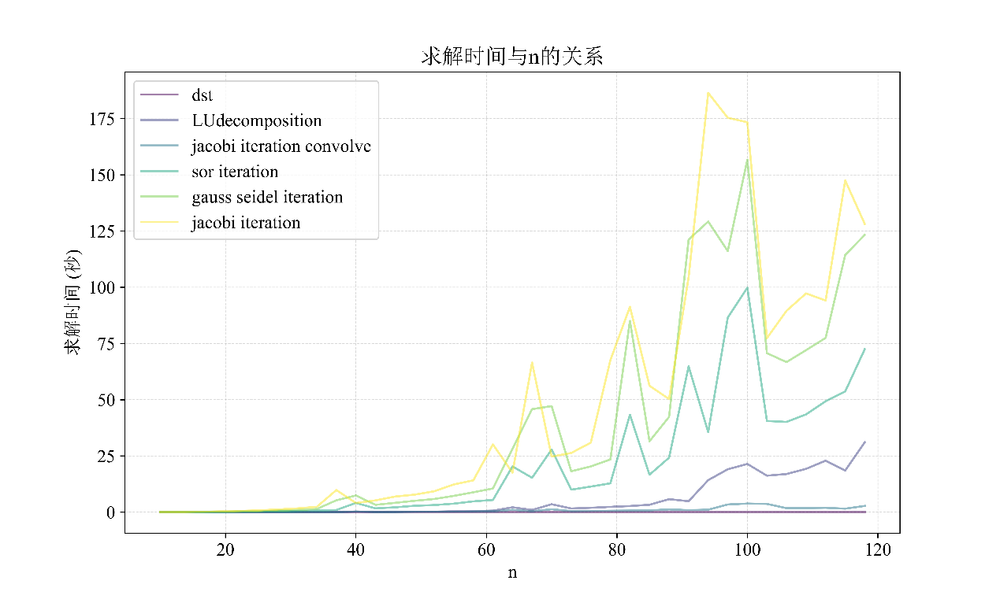
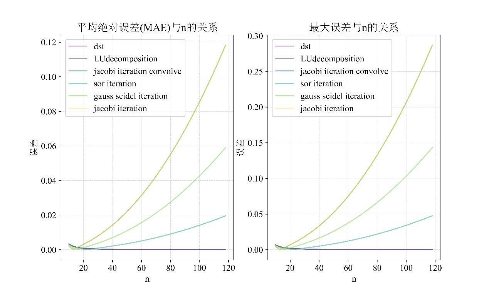
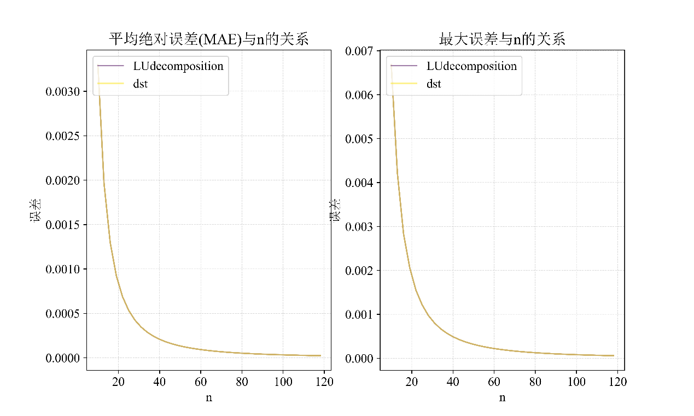
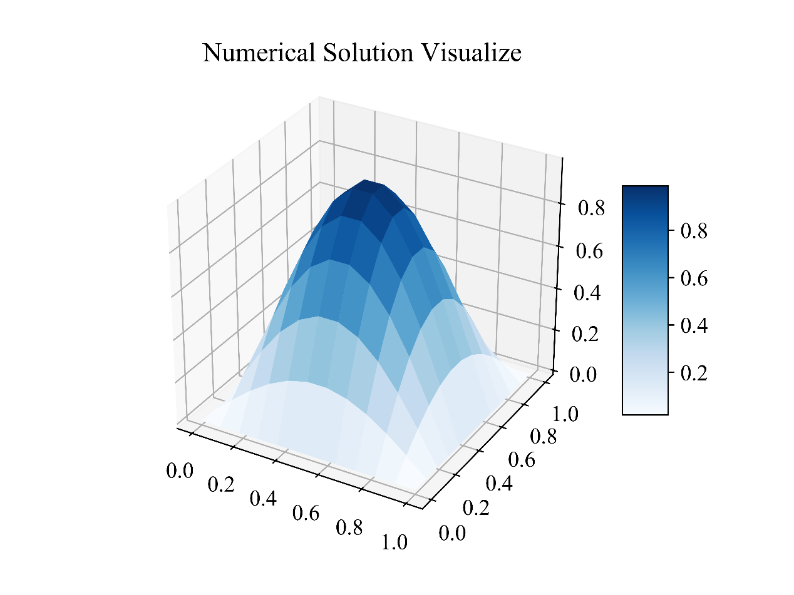
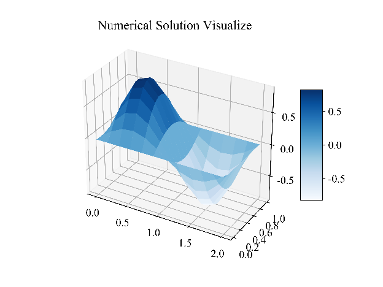
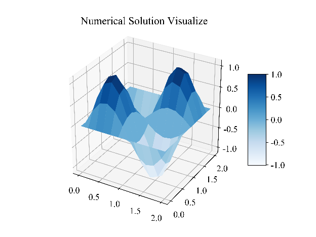
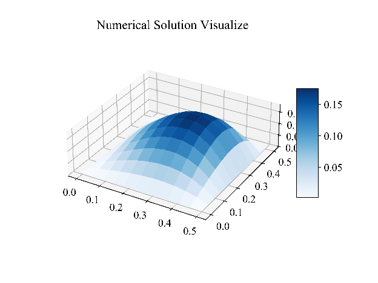
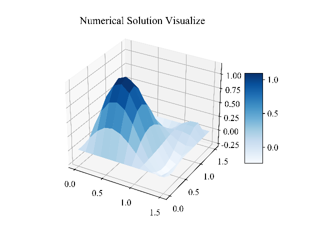
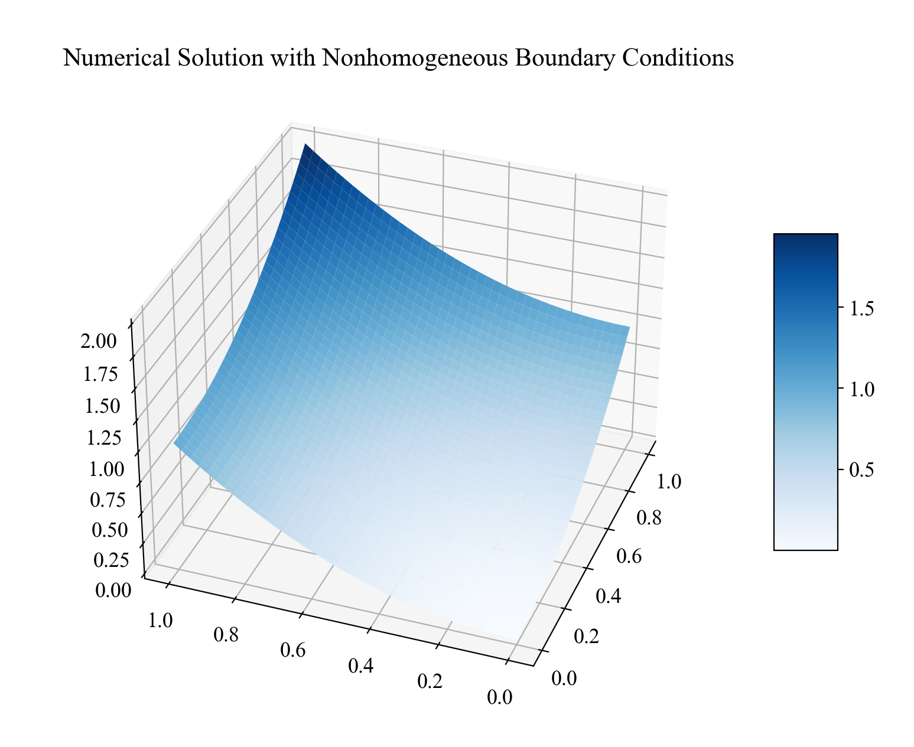
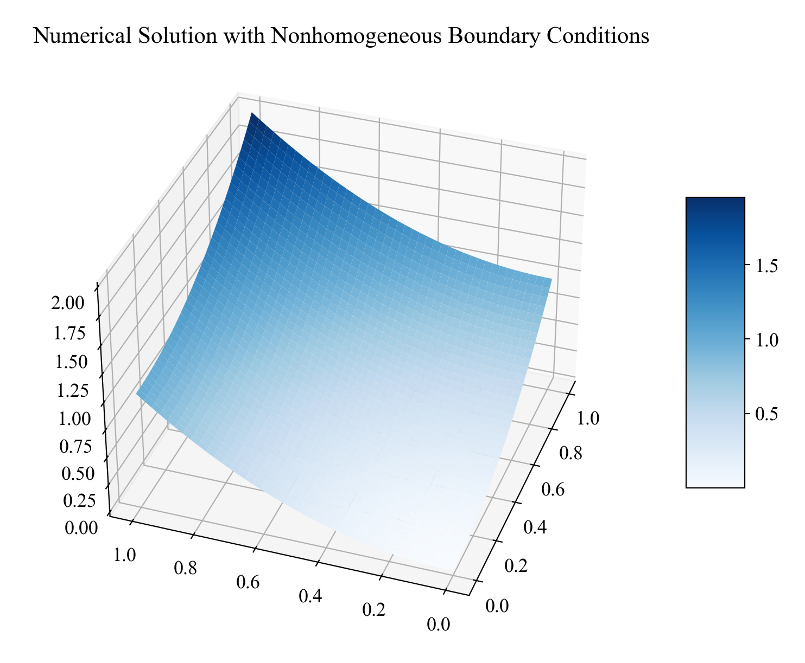

# 五点差分法求解Poisson方程中不同数值解法的比较分析

*上海交通大学 2023-2024 学年春季学期 微分方程数值解（MATH3808-2）课程大作业*

## 1 引言

泊松方程广泛应用于电磁学、流体动力学和热传导等领域。在许多实际应用中，直接求解泊松方程的解析解十分复杂。因此，开发高效的数值求解方法对于这类问题的研究至关重要。本报告旨在通过python数值实验，比较和分析不同数值求解方法在求解定界泊松方程时的性能。特别地，我们关注于离散正弦变换（DST）方法的实现和效率，考察了其在不同网格划分下的求解精度和运行时间，并与其他数值方法如Jacobi迭代、Gauss-Seidel迭代和LU分解方法进行了比较。

## 2 问题描述

对于一个二维矩形域上的满足齐次Dirichlet边界条件的Poisson方程，其形式为：

$$\left\{ \begin{matrix}
\Delta u\left( x,y \right) = f\left( x,y \right),\left( x,y \right) \in \Omega \\
u\left( x,y \right) = 0,\left( x,y \right) \in \partial\Omega \\
\end{matrix} \right.\ ,\Omega = \left( 0,a \right) \times \left( 0,b \right)$$

我们需要使用一系列数值解法来求解上述Poisson方程，并对比分析不同解法的运算效率。

在本次数值实验中，我所选择的具体算例为：

$$\left\{ \begin{matrix}
\Delta u\left( x,y \right) = - 2\pi^{2}\sin\pi x\sin\pi y,\left( x,y \right) \in \Omega \\
u\left( x,y \right) = 0,\left( x,y \right) \in \partial\Omega \\
\end{matrix} \right.\ ,\Omega = \left( 0,1 \right) \times \left( 0,1 \right)$$

这个方程有解析解$u = \sin\pi x\sin\pi y$，能够让我们更加方便地分析数值结果的准确性。

## 3 数值方法

### 3.1 五点差分

将矩形区域在$x$方向划分为$I + 1$等份，$x_{i} = ih$，$y$方向划分为$J + 1$等份，$y_{j} = jh$。将方程的信息离散化（五点差分）：

$$\Delta_{h}u_{\text{ij}} ≔ \frac{u_{i + 1,j} - 2u_{\text{ij}} + u_{i - 1,j}}{h^{2}} + \frac{u_{i,j + 1} - 2u_{\text{ij}} + u_{i,j - 1}}{k^{2}}$$

即：

$$\left\{ \begin{matrix}
\Delta_{h}u_{\text{ij}} = f_{\text{ij}},1 \leq i \leq I,1 \leq j \leq J \\
u_{\text{ij}} = \alpha_{\text{ij}},i \in \left\{ 0,I + 1 \right\} \text{或} j \in \left\{ 0,J + 1 \right\} \\
\end{matrix} \right.\ $$

这种划分求解方式具有稳定性和唯一性，具有二阶精度$O\left( h^{2} \right)$。

### 3.2 迭代法求解

#### 3.2.1 Jacobi迭代法

$$\left\{ \begin{matrix}
u_{\text{ij}}^{\text{new}} = \frac{1}{4}\left( u_{i + 1,j}^{\text{old}} + u_{i - 1,j}^{\text{old}} + u_{i,j + 1}^{\text{old}} + u_{i,j - 1}^{\text{old}} \right) - \frac{1}{4}h^{2}f_{\text{ij}} \\
u_{\text{ij}}^{\text{new}} = u_{\text{ij}}^{\text{old}} = \alpha_{\text{ij}} \\
\end{matrix} \right.\ $$

在用python实现Jacobi迭代法时，我注意到除了使用两层for循环遍历矩阵$U_{\text{old}}$中的每一个元素并利用其周围的值更新$U_{\text{new}}$外，还可以使用卷积的方式来完成计算。

对于$x$轴划分步长为$h$，$y$轴划分步长为$k$的情况，卷积核$K$可以表示为：

$$K = \begin{bmatrix}
0 & \frac{1}{k^{2}} & 0 \\
\frac{1}{h^{2}} & 0 & \frac{1}{h^{2}} \\
0 & \frac{1}{k^{2}} & 0 \\
\end{bmatrix}$$

那么矩阵$U_{\text{new}}$和$U_{\text{old}}$可以表示为：

$$U_{\text{new}} = \left( U_{\text{old}}*K - F \right) \bullet \frac{1}{\frac{2}{h^{2}} + \frac{2}{k^{2}}}$$

在卷积时为了保持$U_{\text{new}}$的形状不变并且边界条件被考虑在内，$U_{\text{new}}$需要在其边界进行补零操作。

scipy提供的卷积方法scipy.signal.convolve2d是一个已经高度优化的函数，对卷积计算有明显的加速。而对于后续的Gauss-Seidel迭代法和SOR迭代法由于需要按照一定顺序进行计算，我无法用卷积的形式去表示。这可能导致利用卷积加速的Jacobi迭代法的迭代次数高于Gauss-Seidel迭代法和SOR迭代法，但总运算速度却快得多。为了更加全面的分析不同迭代法的差距，我编写了两个实践Jacobi迭代法的方法：一个是method\_jacobi\_iteration，用for循环实现；另一个是method\_jacobi\_iteration\_convolve，用scipy.signal.convolve2d实现。

#### 3.2.2 Gauss-Seidel迭代法

Gauss-Seidel迭代法是Jacobi迭代法的一个改进版本，其迭代公式考虑了最新的迭代值，这样可以加快收敛速度。在Gauss-Seidel方法中，每次迭代时使用已经计算出的新值更新未知数，迭代公式为：

$$\left\{ \begin{matrix}
u_{\text{ij}}^{\text{new}} = \frac{1}{4}\left( u_{i + 1,j}^{\text{new}} + u_{i - 1,j}^{\text{new}} + u_{i,j + 1}^{\text{old}} + u_{i,j - 1}^{\text{old}} \right) - \frac{1}{4}h^{2}f_{\text{ij}} \\
u_{\text{ij}}^{\text{new}} = u_{\text{ij}}^{\text{old}} = \alpha_{\text{ij}} \\
\end{matrix} \right.\ $$

与Jacobi方法相比，Gauss-Seidel方法在迭代过程中，一旦计算出一个新的分量，就立即将其用于计算后续的分量。

#### 3.2.3 SOR迭代法

SOR方法是Gauss-Seidel方法的推广，引入了一个松弛因子$\omega$来加速收敛。通过对Gauss-Seidel迭代公式的每次迭代结果进行加权平均，可以得到SOR迭代公式：

$$\left\{ \begin{matrix}
{\widetilde{u}}_{\text{ij}}^{\text{new}} = \frac{1}{4}\left( {\widetilde{u}}_{i + 1,j}^{\text{new}} + {\widetilde{u}}_{i - 1,j}^{\text{new}} + u_{i,j + 1}^{\text{old}} + u_{i,j - 1}^{\text{old}} \right) - \frac{1}{4}h^{2}f_{\text{ij}} \\
{\widetilde{u}}_{\text{ij}}^{\text{new}} = u_{\text{ij}}^{\text{old}} = \alpha_{\text{ij}} \\
\end{matrix} \right.\ $$

$$u_{\text{ij}}^{\text{new}} = \omega{\widetilde{u}}_{\text{ij}}^{\text{new}} + \left( 1 - \omega \right)u_{\text{ij}}^{\text{old}}$$

当$\omega = 1$时，SOR方法退化为Gauss-Seidel方法。选择合适的$\omega$可以显著提高迭代的收敛速度。本次数值实验中我选取的$\omega$为1.5。

### 3.3 解线性方程组

将五点差分格式写为矩阵的形式：

矩阵形式：

$$U = \begin{bmatrix}
u_{11} & u_{12} & \ldots & u_{1J} \\
u_{21} & u_{22} & \ldots & u_{2J} \\
 \vdots & \vdots & \ddots & \vdots \\
u_{I1} & u_{I2} & \ldots & u_{\text{IJ}} \\
\end{bmatrix},F = - \begin{bmatrix}
f_{11} & f_{12} & \ldots & f_{1J} \\
f_{21} & f_{22} & \ldots & f_{2J} \\
 \vdots & \vdots & \ddots & \vdots \\
f_{I1} & f_{I2} & \ldots & f_{\text{IJ}} \\
\end{bmatrix}$$

$$A = \frac{1}{h^{2}}\begin{bmatrix}
2 & - 1 & \  & \  \\
 - 1 & 2 & \ddots & \  \\
\  & \ddots & \ddots & - 1 \\
\  & \  & - 1 & 2 \\
\end{bmatrix}_{I \times I},B = \frac{1}{k^{2}}\begin{bmatrix}
2 & - 1 & \  & \  \\
 - 1 & 2 & \ddots & \  \\
\  & \ddots & \ddots & - 1 \\
\  & \  & - 1 & 2 \\
\end{bmatrix}_{I \times I}$$

$$AU + UB = F$$

将$U$和$F$按照列拉直，得到一个线性方程组：

$$\left( I\bigotimes A + B\bigotimes I \right)\overrightarrow{U} = \overrightarrow{F}$$

这个线性方程组可以使用LU分解来求解。LU分解可以由scipy.linalg.lu\_factor来实现，分解后的求解可以用scipy.linalg.lu\_solve来实现。

### 3.4 离散正弦傅里叶变换

利用线性代数的相关知识可以推导出$U$的表达式：

$$U = \sum_{i = 1}^{I}{\sum_{j = 1}^{J}{\frac{4\mathbf{u}_{i}^{T}F\mathbf{v}_{j}}{\left( \lambda_{i} + \mu_{j} \right)\left( I + 1 \right)\left( J + 1 \right)}\mathbf{u}_{i}\mathbf{v}_{j}^{T}}}$$

其中$\mathbf{u}_{i}$和$\mathbf{v}_{i}$是矩阵$A,B$的特征向量，$\lambda_{i},\mu_{i}$是矩阵$A,B$的特征值。

将矩阵$A$的特征向量按照列排成一个$I \times I$矩阵$P$，矩阵$B$的特征向量按照列排成一个$J \times J$矩阵$Q$。$P$的第$\left( m,n \right)$个元素为$\sin\frac{mn\pi}{I + 1}$，$Q$的第$\left( m,n \right)$个元素为$\sin\frac{mn\pi}{J + 1}$。那么$U$可以表示为：

$$V = PFQ$$

$$w_{\text{ij}} = \frac{4v_{\text{ij}}}{\left( \lambda_{i} + \mu_{j} \right)\left( I + 1 \right)\left( J + 1 \right)}$$

$$U = PWQ$$

在完成上述计算时，最重要的是如何快速计算$V = PFQ$与$U = PWQ$两个大型矩阵运算。考虑到$P,Q$两个矩阵的每一项的特点，可以用离散正弦变换来加速这一矩阵乘法计算，即对$F$或$Q$进行一次按行的离散正弦变换和按列的离散正弦变换。

scipy.fft中提供了离散正弦变换的函数dst。该函数提供了四种类型的离散正弦变换，通过type参数指定，默认是第二类离散正弦变换（type=2）。符合本次矩阵乘法的是type=1，并且再此基础上还需要除以二。并且该函数还接受参数axis，指定是按照行进行离散正弦变换还是按照列进行离散正弦变换。具体实现利用DST加速矩阵运算的代码为：dst\_transform = lambda mat: dst(dst(mat, type=1, axis=1),type=1, axis=0)/4

## 4 实验方法

本次数值实验所求解的方程是定义在$\Omega = \left( 0,x_{\max} \right) \times \left( 0,y_{\max} \right)$上的满足齐次Dirichlet边界条件的Poisson方程。作业所要求的问题1和问题3均已在第3节所说的所有方法中实现。而问题2我会在后续解决。

具体代码逻辑如下：

1.  主类**NumericalSolutionForPossionEquation**：

    1.  初始化方法(**\_\_init\_\_**)：接收格点函数、x轴和y轴的最大值、以及格点数（n），计算格点间隔和x、y坐标点。

    2.  \_**generate\_matrix\_AB**方法：生成泊松方程离散化后的系数矩阵A和B。

    3.  **\_generate\_eigenvalues\_AB**方法：计算矩阵A和B的特征值。

    4.  数值解法

        1.  离散傅里叶变换(**method\_dst**)

        2.  LU分解(**method\_LUdecomposition**)

        3.  Jacobi迭代(**method\_jacobi\_iteration**和**method\_jacobi\_iteration\_convolve**)

        4.  高斯-塞德尔迭代(**method\_gauss\_seidel\_iteration**)

        5.  SOR迭代(**method\_sor\_iteration**)。

    5.  **check\_self**方法：验证数值解的自洽性。

    6.  **check\_analytical\_solution**方法：与解析解进行比较。

    7.  **visualize**方法：可视化数值解。

    8.  **analyze\_solution\_time\_error**方法：分析不同求解方法的时间消耗和误差。

2.  主函数**time\_error\_analysis**：对不同的格点数量（n），通过多种数值解法求解泊松方程，并分析求解时间和误差。

3.  子类**NonhomogeneousPoissonEquation**：推广至非齐次条件

4.  实例：应用主函数于第2节中所举的例子，格点划分数$n$从20增加至120。

## 5 实验结果

### 5.1 求解时间

 

由图中可以看出，随着划分格点数$n$的增加，求解时间大体呈递增的趋势。而运算速度的排序为：

DST&gt;Jacobi迭代（卷积加速）&gt;LU分解&gt;SOR迭代&gt;Gauss-Seidel迭代&gt;Jacobi迭代（无卷积加速）

具体的求解时间列表如下：（单位：秒）

<table><thead><tr class="header"><th><p>方法</p><p><span class="math inline"><strong>n</strong></span></p></th><th>DST</th><th>LU</th><th>Jacobi-卷积</th><th>SOR</th><th>Gauss-Seidel</th><th>Jacobi</th></tr></thead><tbody><tr class="odd"><td>20</td><td>0.000</td><td>0.010</td><td>0.011</td><td>0.120</td><td>0.212</td><td>0.334</td></tr><tr class="even"><td>40</td><td>0.000</td><td>0.060</td><td>0.093</td><td>1.118</td><td>2.046</td><td>3.604</td></tr><tr class="odd"><td>60</td><td>0.001</td><td>0.470</td><td>0.294</td><td>4.843</td><td>12.153</td><td>21.049</td></tr><tr class="even"><td>80</td><td>0.001</td><td>3.636</td><td>0.737</td><td>19.035</td><td>28.867</td><td>49.752</td></tr><tr class="odd"><td>100</td><td>0.004</td><td>9.781</td><td>1.948</td><td>43.808</td><td>71.072</td><td>90.266</td></tr></tbody></table>

与没有卷积加速的Jacobi迭代法相比，DST方法快了约三万倍。

### 5.2 求解精度

 

图中Jacobi-卷积加速和Jacobi曲线完全重合，DST和LU分解法曲线完全重合。

注意到随着$n$的增加迭代方法产生的误差反而更大了。这可能和迭代方法的相关参数有关。在迭代时我们需要判断何时终止迭代，我的代码中判断逻辑为当$U_{\text{new}} - U_{\text{old}}$的绝对值的最大元素小于容忍项$tol = 1.0 \times 10^{- 4}$时终止迭代。在进行实验时，容忍项$\mathrm{tol}$的值是一个定值，没有随$n$一同改变。然而实际上为了达到相同的精度，提高$n$的值的同时也需要减小$\mathrm{tol}$的值。所以图中的误差随着$n$的增大反而减小的现象可能是正常情况，不能据此说明迭代法不收敛。同时由于$\mathrm{tol}$项的存在，根据图像比较不同迭代法的精度可能没有意义。

在图中DST和LU分解方法的变化情况不明显。对于这两种方法绘图如下：

 

二者都是求解同一个矩阵方程，只是计算方法不同，故二者的误差完全一致。并且随着$n$的增加，截断误差单调递减。这与理论上五点差分法的误差为$O\left( h^{2} \right)$相符合。

具体计算误差列表如下：

平均绝对误差：

<table><thead><tr class="header"><th><p>方法</p><p><span class="math inline"><strong>n</strong></span></p></th><th>DST</th><th>LU</th><th>Jacobi-卷积</th><th>SOR</th><th>Gauss-Seidel</th><th>Jacobi</th></tr></thead><tbody><tr class="odd"><td>20</td><td>0.00083</td><td>0.00083</td><td>0.00311</td><td>0.00028</td><td>0.00109</td><td>0.00311</td></tr><tr class="even"><td>40</td><td>0.00021</td><td>0.00021</td><td>0.01425</td><td>0.00213</td><td>0.00697</td><td>0.01425</td></tr><tr class="odd"><td>60</td><td>0.00009</td><td>0.00009</td><td>0.03146</td><td>0.00510</td><td>0.01565</td><td>0.03146</td></tr><tr class="even"><td>80</td><td>0.00005</td><td>0.00005</td><td>0.05514</td><td>0.00906</td><td>0.02753</td><td>0.05514</td></tr><tr class="odd"><td>100</td><td>0.00003</td><td>0.00003</td><td>0.08539</td><td>0.01414</td><td>0.04265</td><td>0.08539</td></tr></tbody></table>

最大误差：

<table><thead><tr class="header"><th><p>方法</p><p><span class="math inline"><strong>n</strong></span></p></th><th>DST</th><th>LU</th><th>Jacobi-卷积</th><th>SOR</th><th>Gauss-Seidel</th><th>Jacobi</th></tr></thead><tbody><tr class="odd"><td>20</td><td>0.0019</td><td>0.0019</td><td>0.0069</td><td>0.0007</td><td>0.0025</td><td>0.0069</td></tr><tr class="even"><td>40</td><td>0.0005</td><td>0.0005</td><td>0.0334</td><td>0.0051</td><td>0.0164</td><td>0.0334</td></tr><tr class="odd"><td>60</td><td>0.0002</td><td>0.0002</td><td>0.0751</td><td>0.0122</td><td>0.0374</td><td>0.0751</td></tr><tr class="even"><td>80</td><td>0.0001</td><td>0.0001</td><td>0.1327</td><td>0.0218</td><td>0.0663</td><td>0.1327</td></tr><tr class="odd"><td>100</td><td>0.0001</td><td>0.0001</td><td>0.2065</td><td>0.0342</td><td>0.1032</td><td>0.2065</td></tr></tbody></table>

### 5.3 求解结果可视化

利用DST方法求解结果如下：

 

将定义域由$\left\lbrack 0,1 \right\rbrack \times \left\lbrack 0,1 \right\rbrack$更改为$\left\lbrack 0,a \right\rbrack \times \left\lbrack 0,b \right\rbrack$：

  

  

## 6 非齐次的方程求解方法

对于非齐次Dirichlet边界条件的Poisson方程，其格式如下：

$$\left\{ \begin{matrix}
\Delta u\left( x,y \right) = f\left( x,y \right),\left( x,y \right) \in \Omega \\
u\left( x,y \right) = \alpha\left( x,y \right),\left( x,y \right) \in \partial\Omega \\
\end{matrix} \right.\ $$

### 6.1 迭代法

对于迭代法，以卷积加速的Jacobi迭代法为例，如果需要修改使得其能够适应，则需要修改卷积时对边界值的填充。齐次方程求解时边界值均填充的是0，而非齐次方程则需要根据$\alpha\left( x,y \right)$的值来填充。

### 6.2 矩阵方程

而对于矩阵方程，我们则需要修改$F$矩阵的中$f_{1j},f_{i1},f_{\text{nj}},f_{\text{in}}$的值使其适配非齐次Dirichlet边界条件。具体修正方案如下：

| 齐次项                                                                                                                                                                                                                                                                                                                                                                                                        | 非齐次修正                                                            |
|---------------------------------------------------------------------------------------------------------------------------------------------------------------------------------------------------------------------------------------------------------------------------------------------------------------------------------------------------------------------------------------------------------------|-----------------------------------------------------------------------|
| $\mathbf{-}\mathbf{f}_{\mathbf{1}\mathbf{j}}\mathbf{=}\frac{\mathbf{2}\mathbf{u}_{\mathbf{1}\mathbf{j}}\mathbf{-}\mathbf{u}_{\mathbf{2}\mathbf{j}}}{\mathbf{h}^{\mathbf{2}}}\mathbf{+}\frac{\mathbf{2}\mathbf{u}_{\mathbf{j}\mathbf{1}}\mathbf{-}\mathbf{u}_{\left( \mathbf{j - 1} \right)\mathbf{1}}\mathbf{-}\mathbf{u}_{\left( \mathbf{j + 1} \right)\mathbf{1}}}{\mathbf{k}^{\mathbf{2}}}$              | $- f_{1j}^{*} = - f_{1j} - \frac{u_{0j}}{h^{2}}$                    |
| $\mathbf{-}\mathbf{f}_{\mathbf{i}\mathbf{1}}\mathbf{=}\frac{\mathbf{2}\mathbf{u}_{\mathbf{i}\mathbf{1}}\mathbf{-}\mathbf{u}_{\left( \mathbf{i - 1} \right)\mathbf{1}}\mathbf{-}\mathbf{u}_{\left( \mathbf{i + 1} \right)\mathbf{1}}}{\mathbf{h}^{\mathbf{2}}}\mathbf{+}\frac{\mathbf{2}\mathbf{u}_{\mathbf{i}\mathbf{1}}\mathbf{-}\mathbf{u}_{\mathbf{i}\mathbf{2}}}{\mathbf{k}^{\mathbf{2}}}$              | $- f_{1j}^{*} = - f_{1j} - \frac{u_{i0}}{k^{2}}$                    |
| $\mathbf{-}\mathbf{f}_{\mathbf{\text{nj}}}\mathbf{=}\frac{\mathbf{2}\mathbf{u}_{\mathbf{\text{nj}}}\mathbf{-}\mathbf{u}_{\left( \mathbf{n - 1} \right)\mathbf{j}}}{\mathbf{h}^{\mathbf{2}}}\mathbf{+}\frac{\mathbf{2}\mathbf{u}_{\mathbf{\text{jn}}}\mathbf{-}\mathbf{u}_{\left( \mathbf{j - 1} \right)\mathbf{n}}\mathbf{-}\mathbf{u}_{\left( \mathbf{j + 1} \right)\mathbf{n}}}{\mathbf{k}^{\mathbf{2}}}$ | $- f_{1j}^{*} = - f_{1j} - \frac{u_{\left( n + 1 \right)j}}{h^{2}}$ |
| $\mathbf{-}\mathbf{f}_{\mathbf{\text{in}}}\mathbf{=}\frac{\mathbf{2}\mathbf{u}_{\mathbf{\text{in}}}\mathbf{-}\mathbf{u}_{\left( \mathbf{i - 1} \right)\mathbf{n}}\mathbf{-}\mathbf{u}_{\left( \mathbf{i + 1} \right)\mathbf{n}}}{\mathbf{h}^{\mathbf{2}}}\mathbf{+}\frac{\mathbf{2}\mathbf{u}_{\mathbf{\text{in}}}\mathbf{-}\mathbf{u}_{\mathbf{i}\left( \mathbf{n - 1} \right)}}{\mathbf{k}^{\mathbf{2}}}$ | $- f_{1j}^{*} = - f_{1j} - \frac{u_{i\left( n + 1 \right)}}{k^{2}}$ |

注意四个角的值要修正两次。同时代码中也需要注意，矩阵方程中的$F$矩阵需要更改，而迭代法中的$F$矩阵不需要更改。

### 6.3 求解结果

示例方程：

$$\left\{ \begin{matrix}
\Delta u = 4,x \in \Omega \\
u = x^{2} + y^{2},x \in \partial\Omega \\
\end{matrix},\Omega = \left( 0,1 \right) \times \left( 0,1 \right) \right.\ $$

这个方程的解析解为$u = x^{2} + y^{2}$。

卷积加速的Jacobi迭代法求解结果（$n = 40$）：

 

与解析解的偏差：最大偏差为0.03394，平均绝对误差为0.01445

DST求解的结果：

 

与解析解的偏差：最大偏差$1.332 \times 10^{- 15}$，平均偏差$2.249 \times 10^{- 16}$。

以上结果表明代码能够顺利地求解非齐次边界条件下的微分方程。

## 7 总结

本次python数值实验综合比较和分析了五点差分法在求解矩形域上Poisson方程时不同数值解法的性能。实验涵盖了离散正弦变换（DST）、Jacobi迭代、Gauss-Seidel迭代、LU分解、SOR迭代这几种方法，在不同网格划分下评估了它们的求解精度和运行时间。结果表明，DST方法在运行速度上显著优于其他方法。在求解精度方面，DST和LU分解方法表现出了较高的准确性。同时，求解代码能够将迭代方法和矩阵方程方法拓充至$\left\lbrack 0,a \right\rbrack \times \left\lbrack 0,b \right\rbrack$与非齐次边界条件的情况。

## 8 附录

```python
import numpy as np
import matplotlib.pyplot as plt
import pandas as pd
import time
import os
from scipy.fft import dst
from scipy.linalg import lu_factor, lu_solve
from mpl_toolkits.mplot3d import Axes3D
from scipy.signal import convolve2d
from matplotlib import font_manager
from matplotlib import rcParams
font_path = "times+simsun.ttf"
font_manager.fontManager.addfont(font_path)
prop = font_manager.FontProperties(fname=font_path)
rcParams['font.family'] = 'sans-serif'
rcParams['font.sans-serif'] = prop.get_name()
rcParams['font.size'] = 13
rcParams['axes.unicode_minus'] = False
class NumericalSolutionForPossionEquation:
    def __init__(
        self,
        lattice_function:callable, # 格点函数
        x_max:float=1.0, # x轴范围：[0,x_max]
        y_max:float=1.0, # y轴范围：[0,y_max]
        n:int=10, # n+1等分x轴与y轴
        ):
        self.x_max = x_max
        self.y_max = y_max
        self.lattice_function = lattice_function
        self.n = n
        self.x_step = x_max/(n+1)
        self.y_step = y_max/(n+1)
        self.x_points = np.linspace(0, x_max, n+2)[1:-1]
        self.y_points = np.linspace(0, y_max, n+2)[1:-1]
        self.matrix_F = lattice_function(self.x_points[:, None], self.y_points)
    def _generate_matrix_AB(self):
        mat = np.zeros((self.n, self.n))
        np.fill_diagonal(mat, 2)
        np.fill_diagonal(mat[:-1, 1:], -1)
        np.fill_diagonal(mat[1:, :-1], -1)
        return mat
    def _generate_eigenvalues_AB(self, step):
        return 4/step**2*np.array([np.sin(i*np.pi*step/2)**2 for i in range(1, self.n+1)])
    def method_dst(self):
        """ 离散傅里叶正弦变换求解 """
        dst_transform = lambda mat: dst(dst(mat, type=1, axis=1),type=1, axis=0)/4
        eigenvalues_A = self._generate_eigenvalues_AB(self.x_step)
        eigenvalues_B = self._generate_eigenvalues_AB(self.y_step)
        V = dst_transform(-self.matrix_F) # 第一个大型矩阵运算：PFQ
        W = V/(eigenvalues_A[:, None] + eigenvalues_B)*4*self.x_step*self.y_step # 利用numpy的广播机制计算W
        U = dst_transform(W) # 第二个大型矩阵运算：PWQ
        return U
    def method_LUdecomposition(self):
        """ 将矩阵U拉直，转化为线性方程组使用LU分解求解 """
        matrix_A = 1/self.x_step**2*self._generate_matrix_AB()
        matrix_B = 1/self.y_step**2*self._generate_matrix_AB()
        I = np.eye(self.n)
        coefficient_matrix = np.kron(I, matrix_A) + np.kron(matrix_B, I)
        resultant_vector = -self.matrix_F.reshape(self.n*self.n, 1)
        lu, piv = lu_factor(coefficient_matrix)
        x = lu_solve((lu, piv), resultant_vector)
        U = x.reshape(self.n, self.n)
        return U
    def method_jacobi_iteration(self, max_iter=20000, tol=1e-4):
        """ 利用Jacobi迭代法求解 """
        iter_count = 0
        U_new = np.zeros((self.n, self.n))
        U_old = np.zeros((self.n, self.n))
        while iter_count < max_iter:
            U_old_pad = np.pad(U_old, pad_width=1, mode='constant', constant_values=0)
            for i in range(self.n):
                for j in range(self.n):
                    i_pad = i+1; j_pad = j+1
                    value_1 = (U_old_pad[i_pad+1, j_pad]+U_old_pad[i_pad-1, j_pad])/self.x_step**2
                    value_2 = (U_old_pad[i_pad, j_pad+1]+U_old_pad[i_pad, j_pad-1])/self.y_step**2
                    value_3 = self.matrix_F[i, j]
                    value_4 = (2/self.x_step**2+2/self.y_step**2)
                    U_new[i, j] = (value_1 + value_2 - value_3)/value_4
            diff = np.max(np.abs(U_old - U_new))
            if diff < tol:
                break
            iter_count += 1
            U_old = U_new.copy()
        else:
            print(f"注意：本方法(method_jacobi_iteration)已经超过最大迭代数{max_iter}，结果可能不收敛。")
        return U_new
    def method_jacobi_iteration_convolve(self, max_iter=20000, tol=1e-4):
        """ 利用Jacobi迭代法求解，迭代过程用scipy提供的卷积函数加速 """
        factor = 1 / (2/self.x_step**2 + 2/self.y_step**2)
        kernel = np.array([
            [0, 1/self.y_step**2, 0],
            [1/self.x_step**2, 0, 1/self.x_step**2],
            [0, 1/self.y_step**2, 0],
            ]) * factor
        iter_count = 0
        U_new = np.zeros((self.n,self.n))
        U_old = np.zeros((self.n,self.n))
        while iter_count < max_iter:
            U_new = convolve2d(U_old, kernel, mode='same', boundary='fill', fillvalue=0) - self.matrix_F * factor
            diff = np.max(np.abs(U_old - U_new))
            if diff < tol:
                break
            U_old = U_new.copy()
            iter_count += 1
        else:
            print(f"注意：本方法(method_jacobi_iteration_convolve)已经超过最大迭代数{max_iter}，结果可能不收敛。")
        return U_new
    def method_gauss_seidel_iteration(self, max_iter=20000, tol=1e-4):
        """ 利用Gauss Seidel迭代法求解 """
        iter_count = 0
        U_new = np.zeros((self.n, self.n))
        U_old = np.zeros((self.n, self.n))
        while iter_count < max_iter:
            for i in range(self.n):
                for j in range(self.n):
                    u_left = U_new[i-1, j] if i > 0 else 0
                    u_right = U_old[i+1, j] if i < self.n-1 else 0
                    u_down = U_new[i, j-1] if j > 0 else 0
                    u_up = U_old[i, j+1] if j < self.n-1 else 0
                    value_1 = (u_left + u_right) / self.x_step**2
                    value_2 = (u_down + u_up) / self.y_step**2
                    value_3 = self.matrix_F[i, j]
                    value_4 = (2 / self.x_step**2 + 2 / self.y_step**2)
                    U_new[i, j] = (value_1 + value_2 - value_3) / value_4
            diff = np.max(np.abs(U_new - U_old))
            if diff < tol:
                break
            U_old = U_new.copy()
            iter_count += 1
        else:
            print(f"注意：本方法(method_gauss_seidel_iteration)已经超过最大迭代数{max_iter}，结果可能不收敛。")
        return U_new
    def method_sor_iteration(self, omega=1.5, max_iter=20000, tol=1e-4):
        """ 利用SOR迭代法求解 """
        iter_count = 0
        U_new = np.zeros((self.n, self.n))
        U_old = U_new.copy()
        while iter_count < max_iter:
            U_old = U_new.copy()
            for i in range(self.n):
                for j in range(self.n):
                    u_left = U_new[i-1, j] if i > 0 else 0
                    u_right = U_old[i+1, j] if i < self.n-1 else 0
                    u_down = U_new[i, j-1] if j > 0 else 0
                    u_up = U_old[i, j+1] if j < self.n-1 else 0
                    value_1 = (u_left + u_right) / self.x_step**2
                    value_2 = (u_down + u_up) / self.y_step**2
                    value_3 = self.matrix_F[i, j]
                    value_4 = (2 / self.x_step**2 + 2 / self.y_step**2)
                    U_new[i, j] += omega * (((value_1 + value_2 - value_3) / value_4) - U_new[i, j])
            diff = np.max(np.abs(U_new - U_old))
            if diff < tol:
                break
            iter_count += 1
        else:
            print(f"注意：本方法(method_sor_iteration)已经超过最大迭代数{max_iter}，结果可能不收敛。")
        return U_new
    def check_self(self, U):
        tol = np.mean(np.abs(self.matrix_F))/100
        kernel = np.array([
            [0, 1 / self.y_step**2, 0],
            [1 / self.x_step**2, -2 * (1 / self.x_step**2 + 1 / self.y_step**2), 1 / self.x_step**2],
            [0, 1 / self.y_step**2, 0],
            ])
        F_estimated = convolve2d(U, kernel, mode='same', boundary='fill', fillvalue=0)
        diff = np.abs(F_estimated - self.matrix_F)
        max_diff = np.max(diff)
        mean_diff = np.mean(diff)
        return max_diff, mean_diff
    def check_analytical_solution(self, U, analytical_solution):
        X, Y = np.meshgrid(self.x_points, self.y_points, indexing='ij')
        U_analytical = analytical_solution(X, Y)
        max_diff = np.max(np.abs(U - U_analytical))
        mae = np.mean(np.abs(U - U_analytical))
        return max_diff, mae
    def visualize(self, U):
        X, Y = np.meshgrid([0]+list(self.x_points)+[self.x_max], [0]+list(self.y_points)+[self.y_max])
        U_pad = np.pad(U, pad_width=1, mode='constant', constant_values=0)
        fig = plt.figure()
        ax = fig.add_subplot(111, projection='3d')
        surf = ax.plot_surface(X, Y, U_pad.T, cmap='Blues')
        fig.colorbar(surf, shrink=0.5, aspect=5)
        ax.set_title('Numerical Solution Visualize')
        ax.set_aspect('equal')
        plt.savefig("result.png", dpi=800)
        plt.show()
    def analyze_solution_time_error(self, analytical_solution=None):
        methods = [
            'method_dst',
            'method_LUdecomposition',
            'method_jacobi_iteration_convolve',
            'method_sor_iteration',
            'method_gauss_seidel_iteration',
            'method_jacobi_iteration',
            ]
        times = []
        max_error = []
        mean_absolute_error = []
        print(f"初始化完成，准备开始求解微分方程。{self.n=}")
        for method in methods:
            start_time = time.time()
            U = getattr(self, method)()
            end_time = time.time()
            if analytical_solution:
                max_diff, mae = self.check_analytical_solution(U, analytical_solution)
                max_error.append(max_diff)
                mean_absolute_error.append(mae)
            times.append(end_time - start_time)
            print(f"\t{method}\t{end_time-start_time:.6f}秒。")
        solution_info = pd.DataFrame(times, index=[i.replace("method_","") for i in methods], columns=['Execution Time (s)'])
        if analytical_solution:
            solution_info["MAE"] = mean_absolute_error
            solution_info["Max Error"] = max_error
        return solution_info
def time_error_analysis(
    lattice_function,
    x_max, y_max,
    analytical_solution,
    n_values, method_list=[
            'method_dst',
            'method_LUdecomposition',
            'method_jacobi_iteration_convolve',
            'method_sor_iteration',
            'method_gauss_seidel_iteration',
            'method_jacobi_iteration',
            ]):
    output_folder = "Solution-Analysis"
    os.makedirs(output_folder, exist_ok=True)
    # 初始化存储结果的字典
    times = {method: [] for method in method_list}
    maes = {method: [] for method in method_list}
    max_errors = {method: [] for method in method_list}
    # 遍历不同的n值
    for n in n_values:
        print(n)
        solution = NumericalSolutionForPossionEquation(lattice_function, x_max, y_max, n)
        for method in method_list:
            start_time = time.time()
            U = getattr(solution, method)()
            end_time = time.time()
            max_diff, mae = solution.check_analytical_solution(U, analytical_solution)
            times[method].append(end_time - start_time)
            maes[method].append(mae)
            max_errors[method].append(max_diff)
    # 绘制求解时间与n的关系图像
    plt.figure(figsize=(10, 6))
    colors = plt.cm.viridis(np.linspace(0, 1, len(method_list)))
    for i, method in enumerate(method_list):
        plt.plot(n_values, times[method], label=method.replace("method_", "").replace("_", " "), color=colors[i], alpha=0.5)
    plt.xlabel('n')
    plt.ylabel('求解时间 (秒)')
    plt.title('求解时间与n的关系')
    plt.legend(loc='upper left')
    plt.grid(True, which='both', linestyle='--', linewidth=0.5, alpha=0.5)
    plt.savefig(os.path.join(output_folder, "time_vs_n.png"), dpi=800)
    plt.close()
    # 绘制MAE和最大误差与n的关系图像
    fig, axs = plt.subplots(1, 2, figsize=(10, 6))
    for i, method in enumerate(method_list):
        axs[0].plot(n_values, maes[method], label=method.replace("method_", "").replace("_", " "), color=colors[i], alpha=0.5)
        axs[1].plot(n_values, max_errors[method], label=method.replace("method_", "").replace("_", " "), color=colors[i], alpha=0.5)
    axs[0].set_title('平均绝对误差(MAE)与n的关系')
    axs[1].set_title('最大误差与n的关系')
    for ax in axs:
        ax.set_xlabel('n')
        ax.set_ylabel('误差')
        ax.legend(loc='upper left')
        ax.grid(True, which='both', linestyle='--', linewidth=0.5, alpha=0.5)
    plt.savefig(os.path.join(output_folder, "errors_vs_n.png"), dpi=800)
    plt.show()
    plt.close()
    # 将数据保存到Excel文件中
    with pd.ExcelWriter(os.path.join(output_folder, "analysis_results.xlsx")) as writer:
        pd.DataFrame(times, index=n_values).to_excel(writer, sheet_name='Times')
        pd.DataFrame(maes, index=n_values).to_excel(writer, sheet_name='MAEs')
        pd.DataFrame(max_errors, index=n_values).to_excel(writer, sheet_name='Max Errors')
class NonhomogeneousPoissonEquation(NumericalSolutionForPossionEquation):
    def __init__(
        self, lattice_function: callable,
        boundary_left: callable=lambda x: x*0, boundary_right: callable=lambda x: x*0,
        boundary_top: callable=lambda x: x*0, boundary_bottom: callable=lambda x: x*0,
        *args, **kwargs
    ):
        super().__init__(lattice_function, *args, **kwargs)
        self.boundary_left = boundary_left
        self.boundary_right = boundary_right
        self.boundary_top = boundary_top
        self.boundary_bottom = boundary_bottom
        self._prepare_boundary_values()
        self.matrix_F_origin = self.matrix_F.copy()
        self._adjust_F_for_boundary()
    def _prepare_boundary_values(self):
        """ 根据边界条件计算非齐次方程 """
        x_points_total = np.linspace(0, self.x_max, self.n+2)
        y_points_total = np.linspace(0, self.y_max, self.n+2)
        self.boundary_values = np.zeros((self.n+2, self.n+2))
        self.boundary_values[:, 0] = self.boundary_left(y_points_total)
        self.boundary_values[:, -1] = self.boundary_right(y_points_total)
        self.boundary_values[0, :] = self.boundary_bottom(x_points_total)
        self.boundary_values[-1, :] = self.boundary_top(x_points_total)
    def _adjust_F_for_boundary(self):
        """ 根据非齐次边界条件调整F矩阵。调整之后不必重写LU分解与DST计算方法了。 """
        h2 = self.x_step**2
        k2 = self.y_step**2
        self.matrix_F[:, 0] -= self.boundary_values[1:-1, 0] / k2
        self.matrix_F[:, -1] -= self.boundary_values[1:-1, -1] / k2
        self.matrix_F[0, :] -= self.boundary_values[0, 1:-1] / h2
        self.matrix_F[-1, :] -= self.boundary_values[-1, 1:-1] / h2
        print(self.matrix_F)
    def method_jacobi_iteration_convolve(self, max_iter=20000, tol=1e-4):
        """ 卷积加速的Jacobi迭代法，适应非齐次边界条件 """
        factor = 1 / (2/self.x_step**2 + 2/self.y_step**2)
        kernel = np.array([
            [0, 1/self.y_step**2, 0],
            [1/self.x_step**2, 0, 1/self.x_step**2],
            [0, 1/self.y_step**2, 0],
            ]) * factor
        iter_count = 0
        U_new = np.zeros((self.n,self.n))
        U_old = np.zeros((self.n,self.n))
        while iter_count < max_iter:
            # 应用边界条件
            U_with_boundary = np.pad(U_old, pad_width=1, mode='constant', constant_values=0)
            U_with_boundary[1:-1, 0] = self.boundary_values[1:-1, 0]    # Left boundary
            U_with_boundary[1:-1, -1] = self.boundary_values[1:-1, -1]  # Right boundary
            U_with_boundary[0, 1:-1] = self.boundary_values[0, 1:-1]    # Top boundary
            U_with_boundary[-1, 1:-1] = self.boundary_values[-1, 1:-1]  # Bottom boundary
            # 卷积运算
            U_new = convolve2d(U_with_boundary, kernel, mode='valid') - self.matrix_F_origin * factor
            diff = np.max(np.abs(U_old - U_new))
            if diff < tol:
                break
            U_old = U_new.copy()
            iter_count += 1
        else:
            print(f"注意：已经超过最大迭代数{max_iter}，结果可能不收敛。")
        return U_new
    def visualize(self, U):
        # 生成网格点，这次包括边界
        X, Y = np.meshgrid(
            [0] + list(self.x_points) + [self.x_max],
            [0] + list(self.y_points) + [self.y_max]
        )
        # 为解U添加边界值
        U_with_boundary = np.pad(
            U, pad_width=1, mode='constant', constant_values=0
        )
        U_with_boundary += self.boundary_values
        # 创建3D图形
        fig = plt.figure()
        ax = fig.add_subplot(111, projection='3d')
        # 绘制曲面图
        surf = ax.plot_surface(X, Y, U_with_boundary.T, cmap='Blues')
        # 添加颜色条以表示高度值
        fig.colorbar(surf, shrink=0.5, aspect=5)
        # 设置标题
        ax.set_title('Numerical Solution with Nonhomogeneous Boundary Conditions')
        # 设置图形的长宽比为相等，这样x, y, z轴的一个单位将被显示为相同的长度
        ax.set_aspect('auto')
        # 保存图像
        plt.savefig("result_with_nonhomogeneous_boundary.png", dpi=800)
        # 显示图像
        plt.show()
def main():
    lattice_function = lambda x, y: -2 * np.pi**2 * np.sin(np.pi * x) * np.sin(np.pi * y)
    analytical_solution = lambda x, y: np.sin(np.pi * x) * np.sin(np.pi * y)
    time_error_analysis(lattice_function, 1, 1, analytical_solution, range(10,120,3))
    test = NumericalSolutionForPossionEquation(lattice_function,1.5,1.5)
    U = test.method_dst()
    test.visualize(U)
    def lattice_function(x, y):
        return 4 * np.ones_like(x) * np.ones_like(y)
    def boundary_left(y):
        return y**2
    def boundary_right(y):
        return 1 + y**2
    def boundary_bottom(x):
        return x**2
    def boundary_top(x):
        return x**2 + 1
    def analytical_solution(x, y):
        return x**2 + y**2
    test = NonhomogeneousPoissonEquation(lattice_function, boundary_left, boundary_right, boundary_top, boundary_bottom, n=40)
    U = test.method_dst()
    print(test.check_analytical_solution(U, analytical_solution))
    test.visualize(U)
```
