# 差分格式稳定性及数值效应比较实验

*上海交通大学 2023-2024 学年春季学期 微分方程数值解（MATH3808-2）课程大作业*

## 引言

对流方程是一类重要的偏微分方程，广泛应用于流体动力学和热传导等领域，其基本形式为 $u_{t} + au_{x} = 0$。在数值求解过程中，差分格式的稳定性是保证计算结果正确性的关键。本报告旨在通过数值实验分析各种差分格式在处理对流方程时的稳定性和间断点表现效果，并将实验结果与理论结果相对比。

## 问题描述

对于对流方程：

$$\left\lbrace \begin{matrix}
u_{t} + au_{x} = 0 \\
u\left( 0,x \right) = f\left( x \right) = 1\ \text{if}\ x \leq 0\ \text{else}\ 0 \\
\end{matrix} \right.\ $$

$x$的网格划分精度为 $h = 0.1$， $t$的网格划分精度为 $\tau = 0.08$，网格比 $\lambda = \frac{\tau}{h} = 0.8$。速度 $a$的取值为 $1,2,4$。

我们需要用不同的差分方法数值求解该方程在 $t = 4.0$时的结果，并对结果的稳定性、间断点附近的计算效果进行分析。

## 理论分析

### 解析解求解

作关于 $x$的傅里叶变换得到：

$$\mathcal{F}\left( u_{t} \right) + a\mathcal{F}\left( u_{x} \right) = 0$$

记 $\widehat{u}\left( t,k \right)= \mathcal{F}\left( u\left( t,x \right) \right)$：

$$\frac{\partial}{\partial t}\widehat{u}\left( t,k \right) + aik\widehat{u}\left( t,k \right) = 0$$

将其看作一个关于 $t$的常微分方程，求解得到：

$$\widehat{u}\left( k,t \right) = \widehat{u}\left( k,0 \right)e^{ikat}$$

对单位阶跃函数作傅里叶变换得到：

$$\widehat{u}\left( k,0 \right) = \pi\delta\left( k \right) + \frac{1}{ik}$$

因此：

$$\widehat{u}\left( k,t \right) = \left( \delta\left( k \right) + \frac{1}{ik} \right)e^{ikat}$$

结合位移性，利用傅里叶逆变换得到：

$$u\left( x,t \right) = f\left( x - at \right)$$

### 差分格式

#### 迎风格式

$$u_{j}^{n + 1} = u_{j}^{n} - a\lambda\left( u_{j}^{n} - u_{j - 1}^{n} \right)$$

#### Beam-Warming格式

$$u_{j}^{n + 1} = u_{j}^{n} - a\lambda\left( u_{j}^{n} - u_{j - 1}^{n} \right) - \frac{a\lambda}{2}\left( 1 - a\lambda \right)\left( u_{j}^{n} - 2u_{j - 1}^{n} + u_{j - 2}^{n} \right)$$

#### Lax-Friedrichs格式

$$u_{j}^{n + 1} = \frac{1}{2}\left( u_{j + 1}^{n} + u_{j - 1}^{n} - \frac{1}{2}a\lambda\left( u_{j + 1}^{n} - u_{j - 1}^{n} \right) \right)$$

#### Lax-Wendroff格式

$$u_{j}^{n + 1} = u_{j}^{n} - \frac{a\lambda}{2}\left( u_{j + 1}^{n} - u_{j - 1}^{n} \right) + \frac{a^{2}\lambda^{2}}{2}\left( u_{j + 1}^{n} - 2u_{j}^{n} + u_{j - 1}^{n} \right)$$

## 实验方法

### 差分方法的实现

在初始化格点矩阵 $u$后，分两层遍历，先遍历时间步长，再遍历空间步长，利用差分格式更新格点矩阵的值。

### 边界处数值的处理

大部分差分方法都需要用到 $u_{j - 1}^{n - 1}$和 $u_{j + 1}^{n - 1}$来计算下一层的 $u_{j}^{n}$。这可能导致在 $u_{J_{\min}}^{n}$和 $u_{J_{\max}}^{n}$附近的数值计算有问题（找不到 $u_{j - 1}^{n - 1}$或 $u_{j + 1}^{n - 1}$）。为此我在初始化格点矩阵时，在 $t = 0$两端额外添加了两个无效数值np.nan，并且让这个无效数值在计算过程中传递下去，用于标记哪些数据是真正用差分格式计算出来的，哪些格式由于涉及边界数值无法计算的。

### 收敛情况的评估

本次实验采用离散L2范数作为截断误差的评估。即：

$$\left| \left| \mathbf{\varepsilon}^{n} \right| \right| = \sqrt{h\sum_{j = - \infty}^{+ \infty}\left( \varepsilon_{j}^{n} \right)^{2}}$$

其中 $h$为空间步长， $\varepsilon_{j}^{n}$是该格点解析解与数值解的偏差。

### 代码框架

ConvectionEquation类

-   初始化：速度 a，空间步长 h，时间步长 tau，计算网格上的时间和空间数组 x 和 t，并初始化解矩阵 u。

-   方法：

    -   initial\_condition: 设置初始条件。

    -   exact\_solution: 计算精确解。

    -   calculate\_error: 计算数值解与精确解的L2误差。

    -   upwind\_scheme: 使用迎风格式计算对流方程的数值解。

    -   beam\_warming\_scheme: 使用Beam-Warming格式计算数值解。

    -   lax\_friedrichs\_scheme: 使用Lax-Friedrichs格式计算数值解。

    -   lax\_wendroff\_scheme: 使用Lax-Wendroff格式计算数值解。

    -   plot\_results: 绘制数值解与精确解的对比图，并显示L2误差。

主程序

-   对于不同的速度值（1, 2, 4），使用上述四种数值格式求解对流方程，并绘制结果图。

## 实验结果

### 迎风格式

#### 求解结果

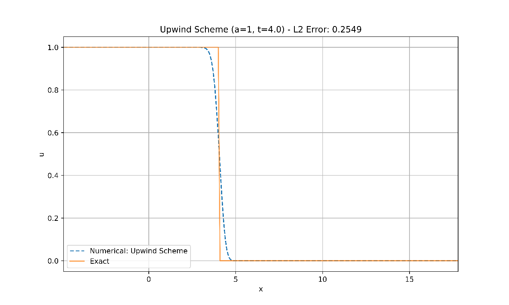 

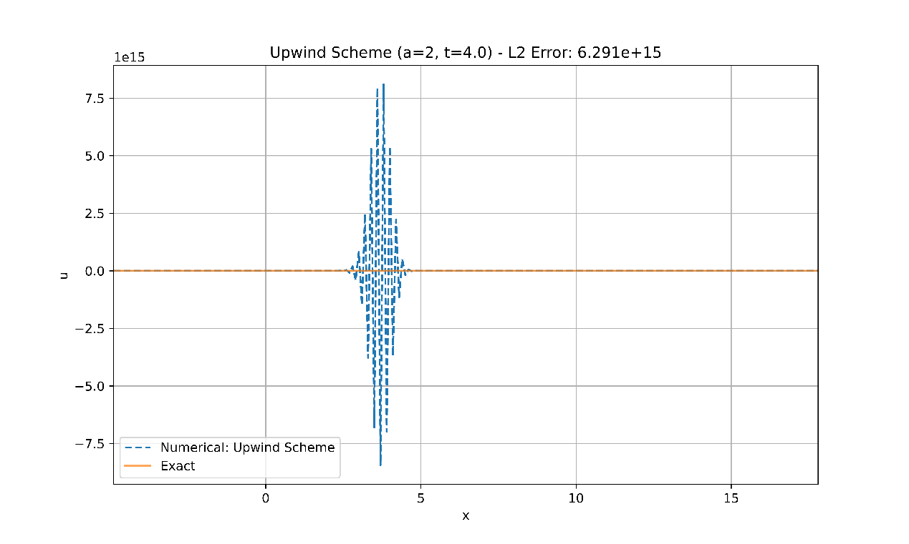 

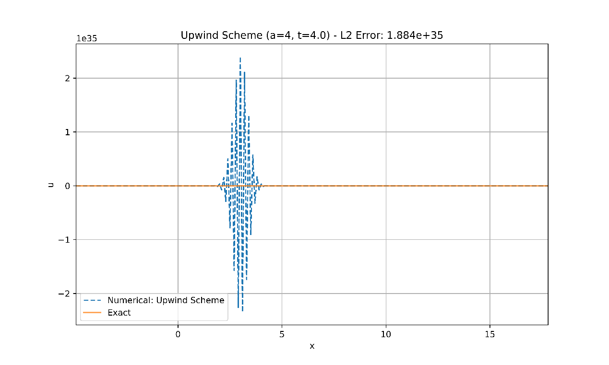 

#### 收敛性分析

截断误差： $O\left( \tau + h \right)$

增长因子： $G = a\lambda e^{- i\omega h} + \left( 1 - a\lambda \right),\lambda = \frac{\tau}{h}$， $\sup G = \max\left( 1,\left( 1 - 2a\lambda \right)^{2} \right)$

收敛条件： $a\lambda \leq 1$

对于本题，当 $a = 1$时该格式收敛， $a = 2,4$时该格式发散。

$a = 1$时，L2误差为0.2549，误差较小，表明此时差分格式收敛。这与理论分析结果吻合。

$a = 2,4$时， $a\lambda > 1$，此时差分格式发散。并且随着 $a$的增大误差也增大。L2误差分别为 $6.291 \times 10^{15}$与 $1.884 \times 10^{35}$，在断点附近的误差尤其明显。实际应用中对于这种情况，需要修正网格网格比以使得 $a\lambda \leq 1$。

#### 间断点附近表现分析

$x$-MPDE： $\frac{1}{2}a\left( 1 - c \right)hu_{\text{xx}} - \frac{1}{6}a\left( c - 1 \right)\left( 2c - 1 \right)h^{2}u_{\text{xxx}}$

一阶耗散为主型。

$a = 1$时，间断点附近曲线大体上平滑的连接在一起，有轻微的振幅波动，基本没有色散现象。这与迎风格式一阶耗散为主型匹配。

### Beam-Warming格式

#### 求解结果

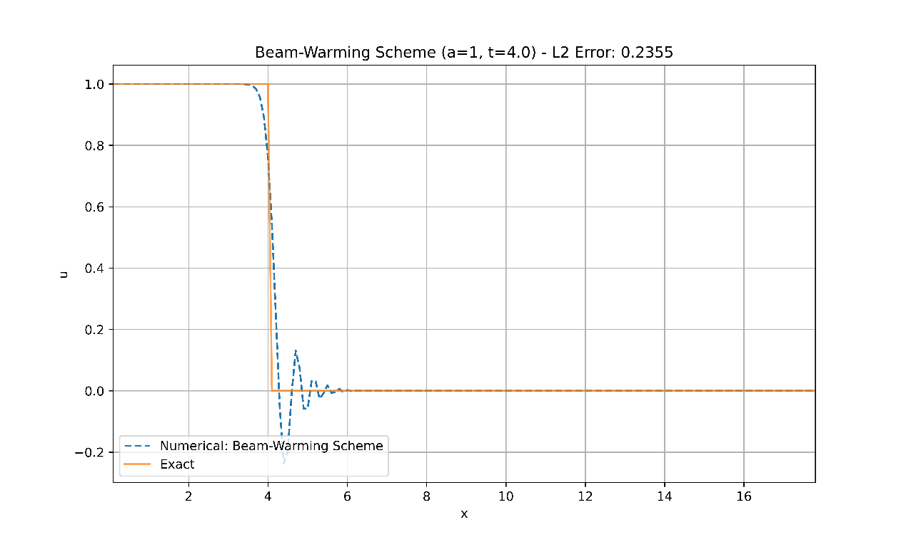 

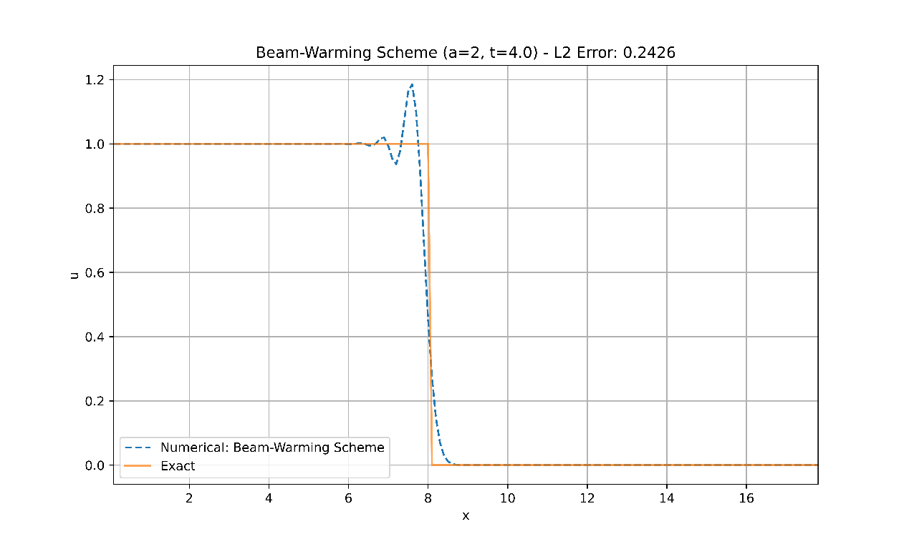 

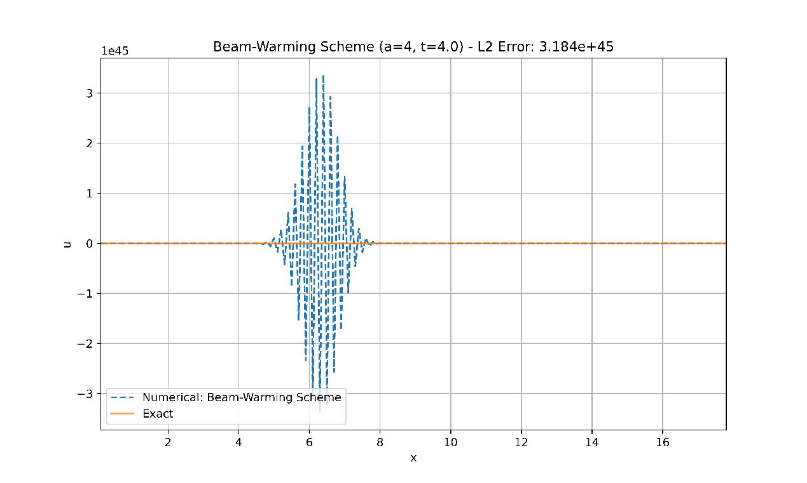 

#### 收敛性分析

增长因子： $\left| G \right|^{2} = 1 - 4a\lambda\left( 1 - a\lambda \right)^{2}\left( 2 - a\lambda \right)\sin^{4}\left( \frac{\omega h}{2} \right)$

收敛条件： $a\lambda \leq 2$

对于本题，当 $a = 1,2$时该格式收敛， $a = 4$时该格式发散。

$a = 1$时，L2误差为0.2355； $a = 2$时，L2误差为0.2426，误差较小，表明数值结果收敛，与理论分析相符合。

$a = 4$时， $a\lambda > 2$，L2误差为 $3.184 \times 10^{45}$。此时差分方法发散。

#### 间断点附近表现分析

$a = 1$时，在间断点附近有较为明显的波尾振荡。

$a = 2$时，在间断点附近有较为明显的波头振荡。

这些振荡呈现出明显的色散效应，表明该格式是色散为主型。

### Lax-Friedrichs格式

#### 求解结果

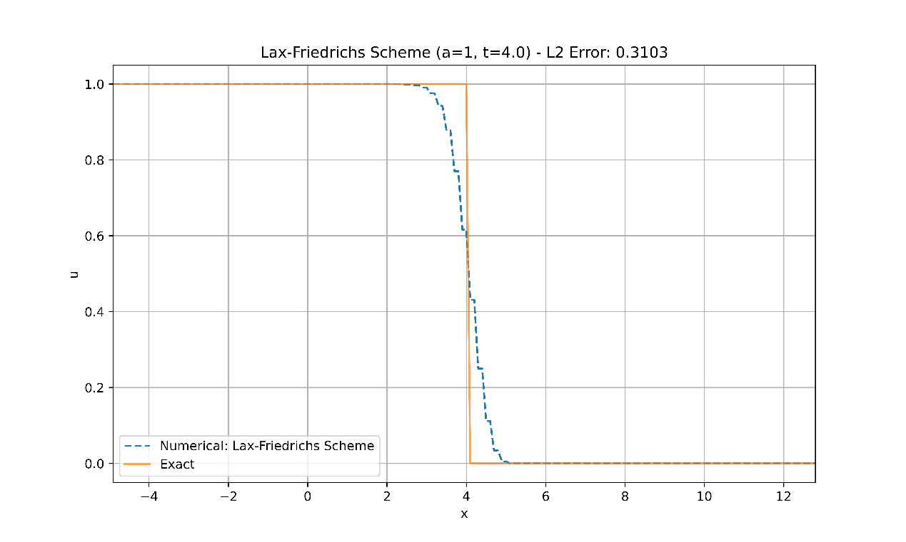 

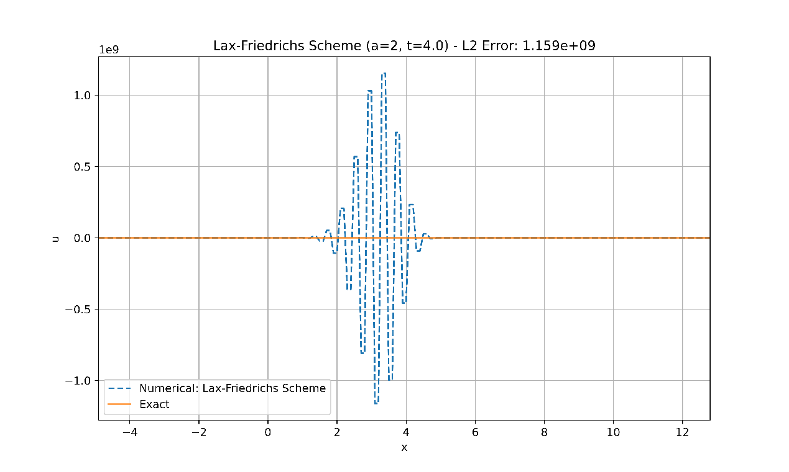 

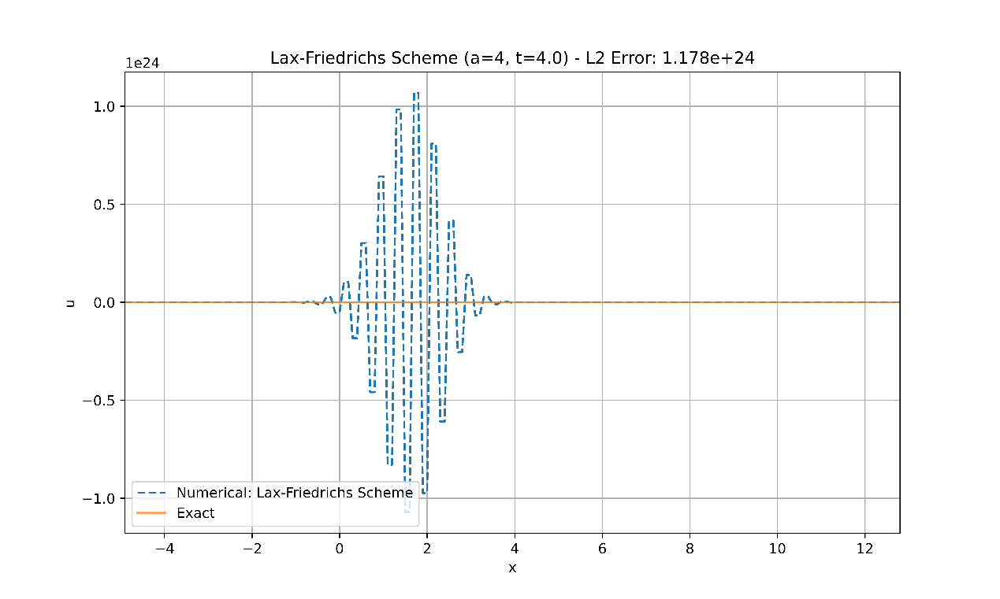 

#### 收敛性分析

截断误差： $O\left( \tau + \frac{h^{2}}{\tau} + h^{2} \right)$

增长因子： $G = \cos\omega h - ia\lambda\sin\omega h,\lambda = \frac{\tau}{h}$， $\sup G = \max\left( 1,a^{2}\lambda^{2} \right)$

收敛条件： $a\lambda \leq 1$

对于本题，当 $a = 1$时该格式收敛， $a = 2,4$时该格式发散。数值结果与理论分析相符合。

#### 间断点附近表现分析

$x$-MPDE： $\frac{1}{2\tau}\left( 1 - c^{2} \right)h^{2}u_{\text{xx}} + \frac{1}{3}a\left( 1 - c^{2} \right)h^{2}u_{\text{xxx}} + \ldots$

$a = 1$时，间断点附近有细微的波纹振动，结果表现出一定的耗散。这与Lax-Friedrichs格式是一阶耗散为主型相匹配。

### Lax-Wendroff格式

#### 求解结果

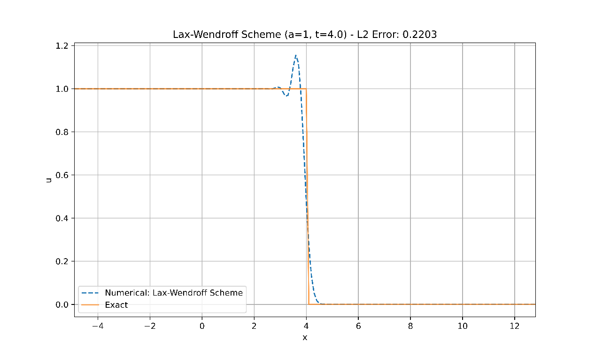 

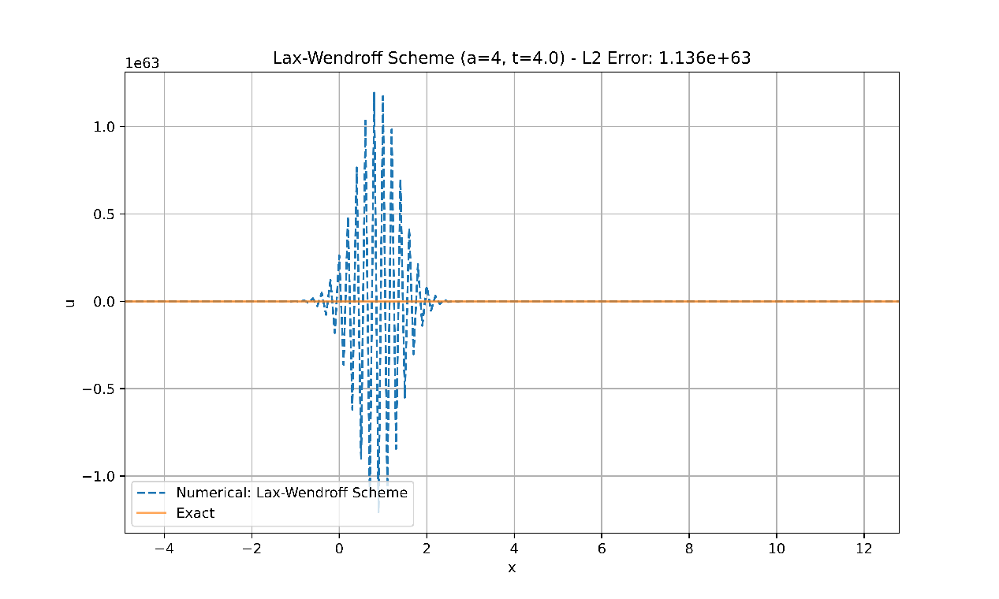 

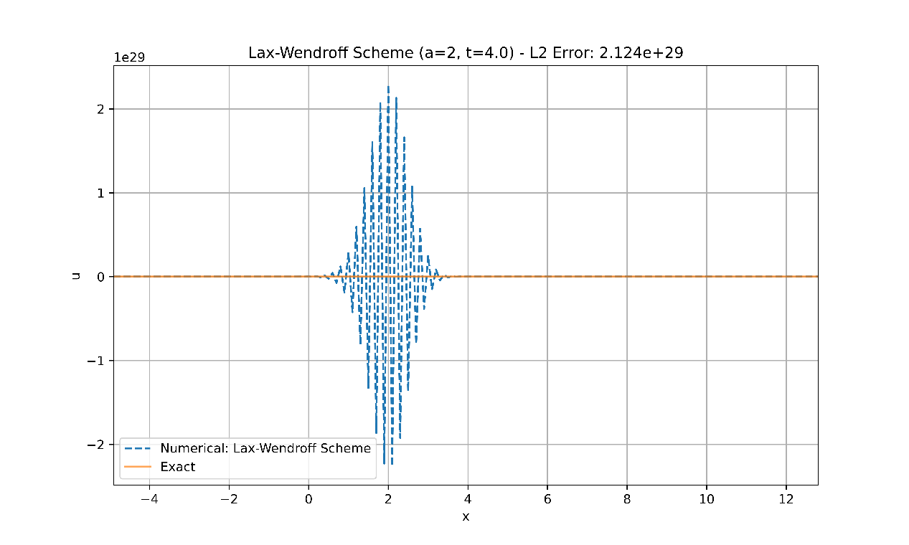 

#### 收敛性分析

截断误差： $O\left( h^{2} + \tau^{2} \right)$

增长因子： $G = 1 - 2a^{2}\lambda^{2}\sin^{2}\frac{\omega h}{2} - ia\lambda\sin\omega h$

收敛条件： $a\lambda \leq 1$

对于本题，当 $a = 1$时该格式收敛， $a = 2,4$时该格式发散。数值实验结果与理论分析相吻合。

#### 间断点附近表现分析

$x$-MPDE： $\frac{1}{6}a\left( c^{2} - 1 \right)h^{2}u_{\text{xxx}} + \frac{1}{8}ac\left( c^{2} - 1 \right)h^{3}u_{\text{xxxx}} + \ldots$

$a = 1$时在间断点的附近波头有明显的振荡，呈现出较为明显的色散效应。这与该格式是一阶色散为主型相符合。

## 总结

### 收敛性

| $\mathbf{a}$ | 迎风格式 | Beam-Warming格式 | Lax-Friedrichs格式 | Lax-Wendroff格式 |
|----------------|----------|------------------|--------------------|------------------|
| 1              | 收敛     | 收敛             | 收敛               | 收敛             |
| 2              | 发散     | 收敛             | 发散               | 发散             |
| 4              | 发散     | 发散             | 发散               | 发散             |

### 间断点的表现

迎风格式：平滑连接，耗散型

Beam-Warming格式：间断点波头/波尾有振荡，色散型

Lax-Friedrichs格式：间断点附近有波纹，耗散型

Lax-Wendroff格式：波头有振荡，色散型

## 附录：数值实验的python代码

```python
import numpy as np
import matplotlib.pyplot as plt
class ConvectionEquation:
    def __init__(self, a, h=0.1, tau=0.08):
        self.a = a
        self.h = h
        self.tau = tau
        self.lambda_ = self.tau / self.h
        self.x = np.arange(-10, 18, self.h)
        self.t = np.arange(0, 4 + self.tau, self.tau)
        self.u = np.full((len(self.t), len(self.x)), np.nan)
    def initial_condition(self):
        return np.array([1 if xi <= 0 else 0 for xi in self.x[1:-1]])
    def exact_solution(self):
        return np.array([1 if xi <= self.a * self.t[-1] else 0 for xi in self.x])
    def calculate_error(self):
        exact_u = np.array([1 if xi <= self.a * self.t[-1] else 0 for xi in self.x])
        epsilon = self.u[-1] - exact_u
        return np.sqrt(self.h * np.nansum(epsilon**2))
    def upwind_scheme(self):
        self.u[0, 1:-1] = self.initial_condition()
        for n in range(0, len(self.t) - 1):
            for j in range(1, len(self.x) - 1):
                self.u[n + 1, j] = self.u[n, j] - self.a * self.lambda_ * (self.u[n, j] - self.u[n, j - 1])
    def beam_warming_scheme(self):
        self.u[0, 1:-1] = self.initial_condition()
        for n in range(0, len(self.t) - 1):
            for j in range(2, len(self.x) - 1):
                self.u[n + 1, j] = (self.u[n, j]
                                    - self.a * self.lambda_ * (self.u[n, j] - self.u[n, j - 1])
                                    - 0.5 * self.a * self.lambda_ * (1 - self.a * self.lambda_) * (self.u[n, j] - 2 * self.u[n, j - 1] + self.u[n, j - 2]))
    def lax_friedrichs_scheme(self):
        self.u[0, 1:-1] = self.initial_condition()
        for n in range(0, len(self.t) - 1):
            for j in range(1, len(self.x) - 1):
                self.u[n + 1, j] = 0.5 * (self.u[n, j + 1] + self.u[n, j - 1]) - 0.5 * self.a * self.lambda_ * (self.u[n, j + 1] - self.u[n, j - 1])
    def lax_wendroff_scheme(self):
        self.u[0, 1:-1] = self.initial_condition()
        for n in range(0, len(self.t) - 1):
            for j in range(1, len(self.x) - 1):
                self.u[n + 1, j] = (self.u[n, j]
                                    - 0.5 * self.a * self.lambda_ * (self.u[n, j + 1] - self.u[n, j - 1])
                                    + 0.5 * (self.a * self.lambda_)**2 * (self.u[n, j + 1] - 2 * self.u[n, j] + self.u[n, j - 1]))
    def plot_results(self, method_name):
        error = self.calculate_error()
        exact_u = self.exact_solution()
        valid_x = self.x[~np.isnan(self.u[-1])]
        valid_u = self.u[-1][~np.isnan(self.u[-1])]
        valid_exact_u = exact_u[~np.isnan(self.u[-1])]
        plt.figure(figsize=(10, 6))
        plt.plot(valid_x, valid_u, linestyle='--', color='#1f77b4', label=f'Numerical: {method_name}')
        plt.plot(valid_x, valid_exact_u, linestyle='-', color='#ff7f0e', alpha=0.7, label='Exact')
        plt.xlabel('x')
        plt.ylabel('u')
        plt.title(f'{method_name} (a={self.a}, t={self.t[-1]}) - L2 Error: {error:.4g}')
        plt.legend(loc='lower left')
        plt.grid(True)
        plt.xlim(valid_x[0], valid_x[-1])
        plt.savefig(f"{method_name}, a={self.a}.png", dpi=800)
        plt.show()
speeds = [1, 2, 4]
for speed in speeds:
    ce = ConvectionEquation(a=speed)
    ce.upwind_scheme()
    ce.plot_results("Upwind Scheme")
    ce = ConvectionEquation(a=speed)
    ce.beam_warming_scheme()
    ce.plot_results("Beam-Warming Scheme")
    ce = ConvectionEquation(a=speed)
    ce.lax_friedrichs_scheme()
    ce.plot_results("Lax-Friedrichs Scheme")
    ce = ConvectionEquation(a=speed)
    ce.lax_wendroff_scheme()
    ce.plot_results("Lax-Wendroff Scheme")
```
